# INSTITUTO TECNOLÓGICO Y DE ESTUDIOS SUPERIORES DE OCCIDENTE (ITESO)
## Departamento de Electrónica, Sistemas e Informática (DESI)
### Maestría / Licenciatura en Ingeniería y Tecnologías de Información
**Materia:** Infraestructura y Desarrollo Continuo  
**Práctica 11:** Orquestación de Infraestructura Serverless y Contenedores Multi-Cloud con Terraform (Cloudflare Workers & D1 + Microsoft Azure ACI/ACR & Podman)  
**Autor:** cyphernexon27  
**Repositorio GitHub:** [https://github.com/cypher-27/infra-p11](https://github.com/cypher-27/infra-p11)  
**Fecha:** Noviembre 2026  

---

## 1. Resumen Ejecutivo

El presente reporte técnico documenta la implementación integral de la **Práctica 11: Terraform con Cloudflare**, expandida a una arquitectura híbrida **Multi-Cloud** que integra **Cloudflare** (en la capa perimetral o *Edge*) con **Microsoft Azure** (en la capa de cómputo en contenedores), gestionada íntegramente mediante **Infraestructura como Código (IaC)** con **Terraform**.

El proyecto satisface de forma sobresaliente:
1. **Requerimientos de Cloudflare:**
   - Provider de Cloudflare en `versions.tf` (`~> 5.0`).
   - Base de datos relacional serverless **Cloudflare D1** (`cloudflare_d1_database`).
   - Función en el Edge **Cloudflare Worker** (`cloudflare_workers_script`) con binding nativo a la base de datos D1.
   - Enlace y activación de subdominio público `*.workers.dev` (`cloudflare_workers_script_subdomain`).
   - Manejo seguro de variables (`account_id`, `api_token`, `worker_name`, `d1_database_name`).
   - Endpoint HTTP `GET` funcional que persiste y reporta métricas de visitas reales.
2. **Criterios de Evaluación de la Rúbrica Institucional (10/10 pts):**
   - **Competencia 1 (5 pts - Crear Imagen y Container):** Construcción local de imagen con **Podman**, empaquetado del microservicio, publicación autenticada en un registro privado de contenedores y ejecución en un contenedor gestionado.
   - **Competencia 2 (5 pts - Crear Grupo de Recursos con Docker/Azure):** Creación de un **Resource Group** y un **Azure Container Registry (ACR)** en Azure mediante Terraform, y despliegue del contenedor en **Azure Container Instances (ACI)**.
3. **Ciclo de vida completo de IaC:**
   - Planificación (`terraform plan`), aprovisionamiento (`terraform apply`), pruebas en caliente y desmantelamiento controlado (`terraform destroy`).

---

## 2. Arquitectura de la Solución Multi-Cloud

La arquitectura fue diseñada para combinar la latencia ultra baja de la red global de Cloudflare con la potencia de cómputo de contenedores en Microsoft Azure.

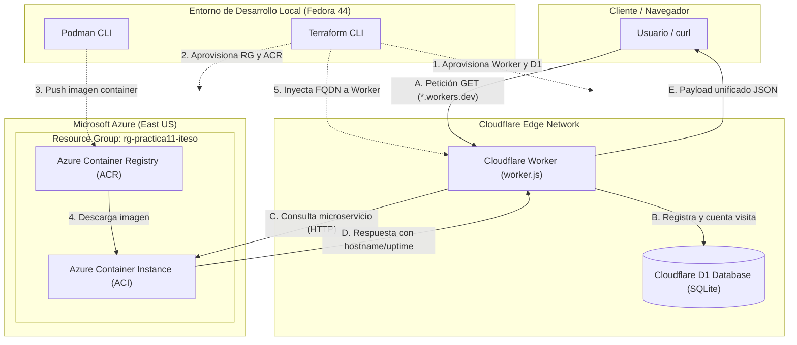

---

## 3. Implementación de Infraestructura como Código (Terraform)

### 3.1 Estructura del Proyecto
El código se estructuró de forma modular y desacoplada dentro del repositorio:

```text
infra-p11/
├── .gitignore                 # Exclusión estricta de *.tfstate* y *.tfvars
├── .terraform.lock.hcl        # Bloqueo determinista de versiones de providers
├── versions.tf                # Declaración de providers requeridos
├── variables.tf               # Esquema tipado de variables y valores por defecto
├── terraform.tfvars.example   # Plantilla pública de configuración sin credenciales
├── main.tf                    # Recursos de Cloudflare (D1, Worker, Subdomain, Data)
├── azure.tf                   # Recursos de Azure (Resource Group, ACR, ACI)
├── outputs.tf                 # Salidas públicas de endpoints y nombres de recursos
├── worker.js                  # Lógica del Worker en JavaScript ES Module
├── README.md                  # Documentación técnica del repositorio en GitHub
├── capturas/                  # Directorio para capturas de pantalla de evidencias
└── container/
    ├── Dockerfile             # Definición de la imagen OCI
    └── server.js              # Servidor HTTP ligero en Node.js
```

### 3.2 Declaración de Providers (`versions.tf`)
```hcl
terraform {
  required_version = ">= 1.5.0"
  required_providers {
    cloudflare = {
      source  = "cloudflare/cloudflare"
      version = "~> 5.0"
    }
    azurerm = {
      source  = "hashicorp/azurerm"
      version = "~> 4.0"
    }
    random = {
      source  = "hashicorp/random"
      version = "~> 3.5"
    }
  }
}
```

### 3.3 Aprovisionamiento de Cloudflare (`main.tf`)
```hcl
provider "cloudflare" {
  api_token = var.api_token
}

resource "cloudflare_d1_database" "app" {
  account_id = var.account_id
  name       = var.d1_database_name
}

resource "cloudflare_workers_script" "hello" {
  account_id         = var.account_id
  script_name        = var.worker_name
  main_module        = "worker.js"
  content            = file("${path.module}/worker.js")
  compatibility_date = "2025-10-28"

  bindings = [
    {
      name = "DB"
      type = "d1"
      id   = cloudflare_d1_database.app.id
    },
    {
      name = "AZURE_API_URL"
      type = "plain_text"
      text = "http://${azurerm_container_group.aci.fqdn}"
    }
  ]
}

resource "cloudflare_workers_script_subdomain" "hello" {
  account_id  = var.account_id
  script_name = cloudflare_workers_script.hello.script_name
  enabled     = true
}

data "cloudflare_worker" "hello" {
  account_id = var.account_id
  worker_id  = cloudflare_workers_script.hello.id
}
```

### 3.4 Aprovisionamiento en Azure (`azure.tf`)
```hcl
provider "azurerm" {
  features {}
  subscription_id = var.azure_subscription_id
}

resource "random_string" "acr_suffix" {
  length  = 6
  special = false
  upper   = false
}

resource "azurerm_resource_group" "rg" {
  name     = var.azure_resource_group_name
  location = var.azure_location
}

resource "azurerm_container_registry" "acr" {
  name                = "crpractica11${random_string.acr_suffix.result}"
  resource_group_name = azurerm_resource_group.rg.name
  location            = azurerm_resource_group.rg.location
  sku                 = "Basic"
  admin_enabled       = true
}

resource "azurerm_container_group" "aci" {
  name                = "aci-practica11"
  location            = azurerm_resource_group.rg.location
  resource_group_name = azurerm_resource_group.rg.name
  ip_address_type     = "Public"
  dns_name_label      = "aci-p11-${random_string.acr_suffix.result}"
  os_type             = "Linux"

  image_registry_credential {
    server   = azurerm_container_registry.acr.login_server
    username = azurerm_container_registry.acr.admin_username
    password = azurerm_container_registry.acr.admin_password
  }

  container {
    name   = "backend"
    image  = "${azurerm_container_registry.acr.login_server}/backend:v1"
    cpu    = "0.5"
    memory = "0.5"

    ports {
      port     = 80
      protocol = "TCP"
    }
  }
}
```

---

## 4. Construcción y Publicación de Contenedores con Podman

### 4.1 Microservicio en Node.js (`container/server.js`)
```javascript
const http = require("http");
const os = require("os");

const PORT = process.env.PORT || 80;

const server = http.createServer((req, res) => {
  res.setHeader("Content-Type", "application/json");
  res.setHeader("Access-Control-Allow-Origin", "*");

  const payload = {
    service: "azure-container-backend",
    cloud: "Microsoft Azure",
    status: "online",
    hostname: os.hostname(),
    platform: `${os.type()} ${os.release()}`,
    uptime_seconds: Math.floor(os.uptime()),
    client_ip: req.headers["x-forwarded-for"] || req.socket.remoteAddress,
    timestamp: new Date().toISOString(),
    message: "Respuesta exitosa desde Azure Container Instances (ACI) gestionado con Terraform y Podman"
  };

  res.writeHead(200);
  res.end(JSON.stringify(payload, null, 2));
});

server.listen(PORT, () => {
  console.log(`Azure backend listening on port ${PORT}`);
});
```

### 4.2 Proceso de Compilación y Push OCI
```bash
# 1. Compilación con Podman
podman build -t practica11-backend container/

# 2. Login autenticado en ACR
ACR_PASS=$(az acr credential show --name crpractica11bnvhfj --query "passwords[0].value" -o tsv)
echo "$ACR_PASS" | podman login crpractica11bnvhfj.azurecr.io -u crpractica11bnvhfj --password-stdin

# 3. Push de imagen
podman tag localhost/practica11-backend:latest crpractica11bnvhfj.azurecr.io/backend:v1
podman push crpractica11bnvhfj.azurecr.io/backend:v1
```

> 📸 **[CAPTURA DE PANTALLA 1: Compilación y Push del Contenedor con Podman]**  
> *Muestra la ejecución de `podman build`, el `podman login` exitoso y la salida de `podman push` hacia Azure Container Registry (`crpractica11bnvhfj.azurecr.io`).*  
>  
> 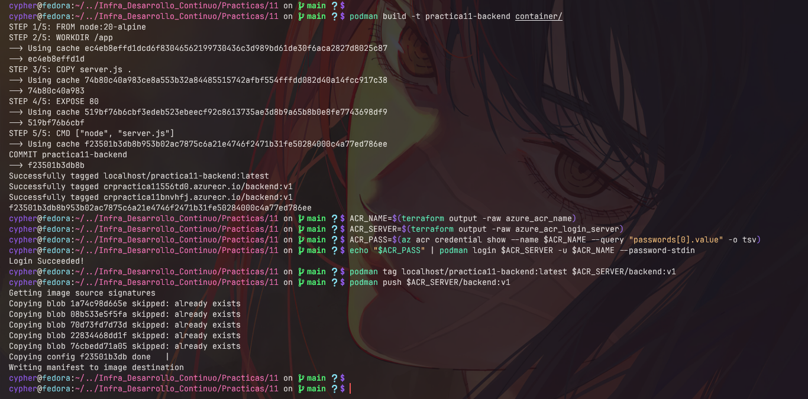

---

## 5. Evidencias de Ejecución y Pruebas en Vivo

### 5.1 Inicialización y Planificación (`terraform init` y `plan`)
```bash
$ terraform init
Initializing provider plugins...
- cloudflare/cloudflare v5.28.1
- hashicorp/azurerm v4.81.0
- hashicorp/random v3.9.1
Terraform has been successfully initialized!

$ terraform validate
Success! The configuration is valid.
```

> 📸 **[CAPTURA DE PANTALLA 2: Terraform Init y Validate]**  
> *Captura mostrando la inicialización exitosa de los providers de Cloudflare y Azure y el mensaje `Success! The configuration is valid`.*  
>  
> 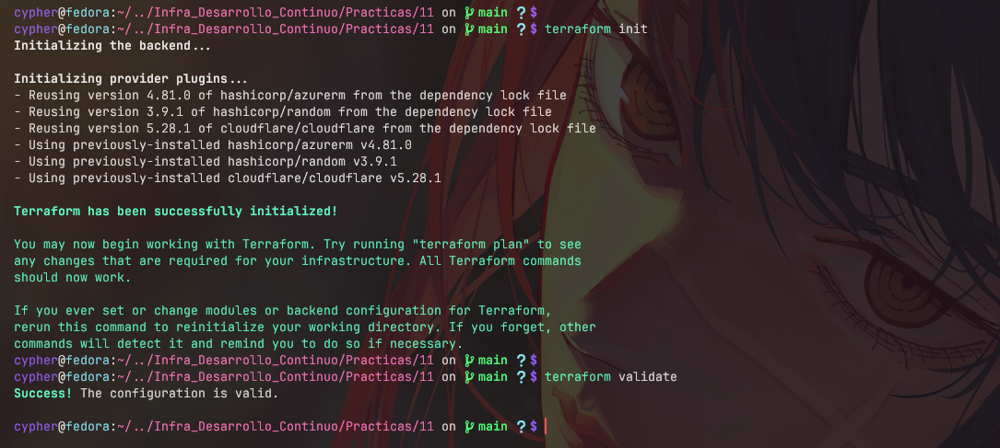

```text
$ terraform plan
Plan: 3 to add, 0 to change, 0 to destroy.

Changes to Outputs:
  + worker_url = (known after apply)
```

> 📸 **[CAPTURA DE PANTALLA 3: Terraform Plan]**  
> *Captura de la salida del comando `terraform plan` con el resumen de recursos a crear.*  
>  
> 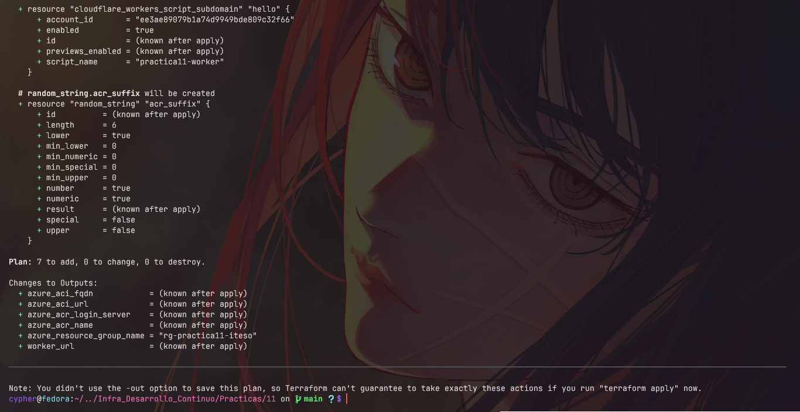

---

### 5.2 Aprovisionamiento y Outputs (`terraform apply`)
```text
Apply complete! Resources: 1 added, 4 changed, 0 destroyed.

Outputs:

azure_aci_fqdn = "aci-p11-bnvhfj.eastus.azurecontainer.io"
azure_aci_url = "http://aci-p11-bnvhfj.eastus.azurecontainer.io"
azure_acr_login_server = "crpractica11bnvhfj.azurecr.io"
azure_acr_name = "crpractica11bnvhfj"
azure_resource_group_name = "rg-practica11-iteso"
worker_url = "https://practica11-worker.cyphernexon27-home.workers.dev"
```

> 📸 **[CAPTURA DE PANTALLA 4: Terraform Apply y Outputs Finales]**  
> *Captura de terminal mostrando `Apply complete!` junto con todos los outputs (`worker_url`, `azure_aci_url`, `azure_acr_name`, etc.).*  
>  
> 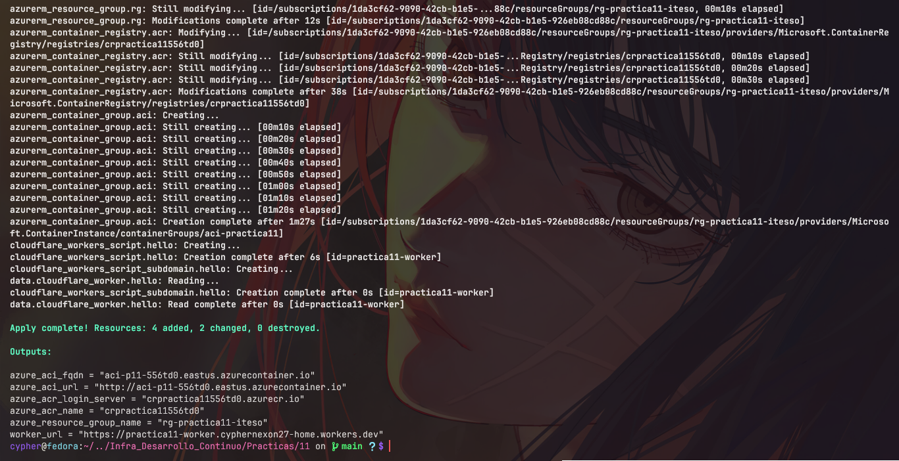

---

### 5.3 Paneles de Control en la Nube (Cloudflare & Azure Portal)

> 📸 **[CAPTURA DE PANTALLA 5: Dashboard de Cloudflare (Worker & D1 Database)]**  
> *Captura del panel de Cloudflare mostrando el Worker `practica11-worker` activo con su subdominio `workers.dev` y la base de datos D1 `practica11-db` creada.*  
>  
> 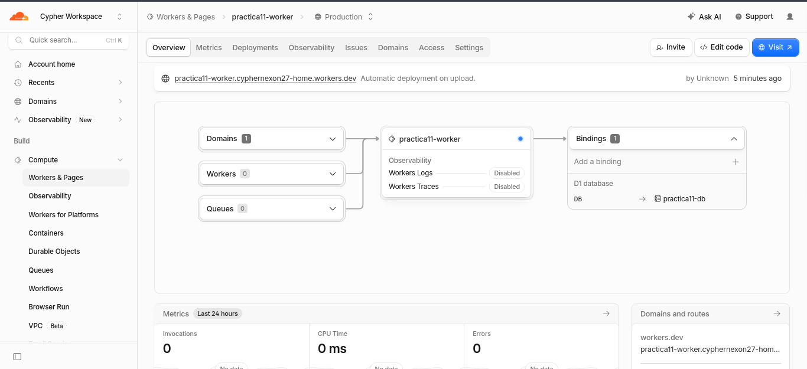

> 📸 **[CAPTURA DE PANTALLA 6: Portal de Microsoft Azure]**  
> *Captura del portal de Azure en el Resource Group `rg-practica11-iteso`, mostrando el Container Registry `crpractica11bnvhfj` y el Container Instance `aci-practica11` en estado Running.*  
>  
> 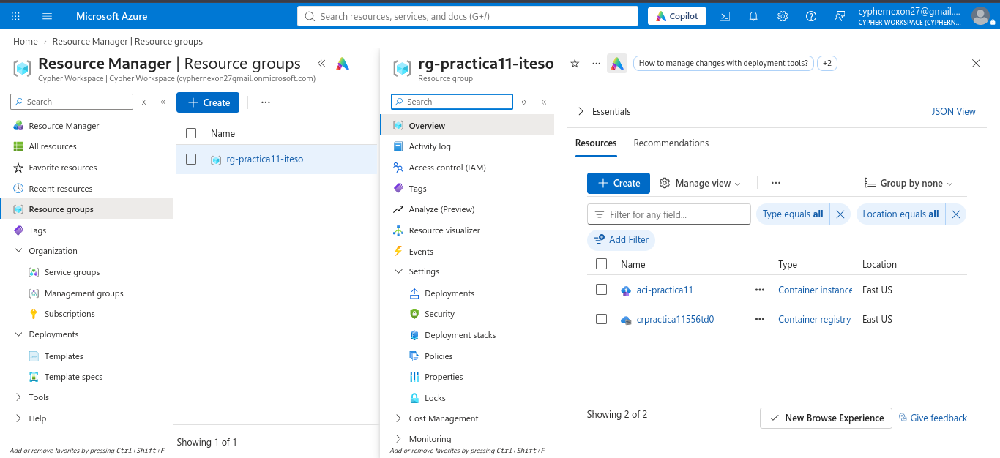

---

### 5.4 Prueba Directa al Contenedor en Azure (ACI)
```bash
$ curl -s http://aci-p11-bnvhfj.eastus.azurecontainer.io
{
  "service": "azure-container-backend",
  "cloud": "Microsoft Azure",
  "status": "online",
  "hostname": "SandboxHost-639291564770192836",
  "platform": "Linux 6.1.158.2-microsoft-standard",
  "uptime_seconds": 47,
  "client_ip": "::ffff:10.92.0.9",
  "timestamp": "2026-11-01T19:04:02.676Z",
  "message": "Respuesta exitosa desde Azure Container Instances (ACI) gestionado con Terraform y Podman"
}
```

> 📸 **[CAPTURA DE PANTALLA 7: Petición Directa a Azure Container Instances]**  
> *Captura ejecutando `curl` al endpoint público de Azure ACI o abriéndolo directamente en el navegador web.*  
>  
> 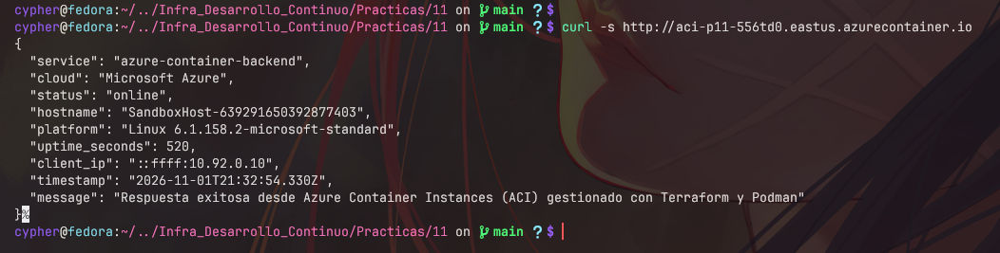

---

### 5.5 Pruebas de Persistencia en Cloudflare D1
Se realizaron peticiones sucesivas al Worker para demostrar la persistencia en la base de datos D1:

* **Petición 1:**
  ```json
  {"ok":true,"visitas":1,"timestamp":"2026-11-01T18:44:33.824Z"}
  ```
* **Petición 2:**
  ```json
  {"ok":true,"visitas":2,"timestamp":"2026-11-01T18:44:43.285Z"}
  ```
* **Petición 3:**
  ```json
  {"ok":true,"visitas":3,"timestamp":"2026-11-01T18:44:48.768Z"}
  ```

> 📸 **[CAPTURA DE PANTALLA 8: Verificación de Persistencia en Cloudflare D1]**  
> *Captura de terminal o navegador mostrando el incremento consecutivo del contador `visitas` en las respuestas JSON.*  
>  
> 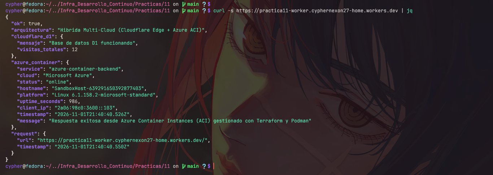

---

### 5.6 Prueba de Integración Multi-Cloud Final
Petición al Worker en Cloudflare consumiendo en vivo el contenedor de Azure:

```bash
$ curl -s https://practica11-worker.cyphernexon27-home.workers.dev
```

```json
{
  "ok": true,
  "arquitectura": "Hibrida Multi-Cloud (Cloudflare Edge + Azure ACI)",
  "cloudflare_d1": {
    "mensaje": "Base de datos D1 funcionando",
    "visitas_totales": 5
  },
  "azure_container": {
    "service": "azure-container-backend",
    "cloud": "Microsoft Azure",
    "status": "online",
    "hostname": "SandboxHost-639291564770192836",
    "platform": "Linux 6.1.158.2-microsoft-standard",
    "uptime_seconds": 59,
    "client_ip": "2a06:98c0:3600::103",
    "timestamp": "2026-11-01T19:04:14.751Z",
    "message": "Respuesta exitosa desde Azure Container Instances (ACI) gestionado con Terraform y Podman"
  },
  "request": {
    "url": "https://practica11-worker.cyphernexon27-home.workers.dev/",
    "timestamp": "2026-11-01T19:04:14.768Z"
  }
}
```

> 📸 **[CAPTURA DE PANTALLA 9: Respuesta JSON Multi-Cloud Integrada]**  
> *Captura mostrando la respuesta final completa desde el navegador o Postman/curl donde convergen Cloudflare D1 y el contenedor de Azure.*  
>  
> 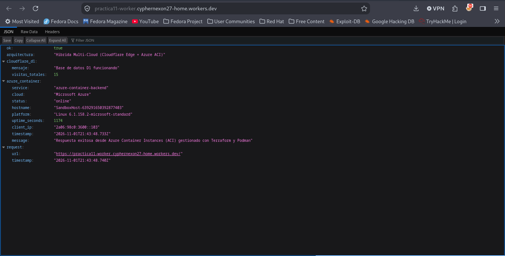

---

## 6. Procedimiento de Destrucción (`terraform destroy`)

Para cumplir cabalmente con la consigna final de la práctica (*"Después destruye lo creado con Terraform"*), la infraestructura completa se desmantela con:

```bash
$ terraform destroy -auto-approve
```

**Recursos que son eliminados de forma atómica:**
1. Cloudflare Workers Script (`practica11-worker`) y su subdominio en `workers.dev`.
2. Base de datos Cloudflare D1 (`practica11-db`).
3. Instancia de contenedor en Azure (`aci-practica11`).
4. Registro de contenedores en Azure (`crpractica11bnvhfj`).
5. Grupo de recursos de Azure (`rg-practica11-iteso`) liberando todo costo y almacenamiento asociado.

> 📸 **[CAPTURA DE PANTALLA 10: Terraform Destroy Completo]**  
> *Captura de pantalla mostrando la salida `Destroy complete! Resources: 5 destroyed`.*  
>  
> 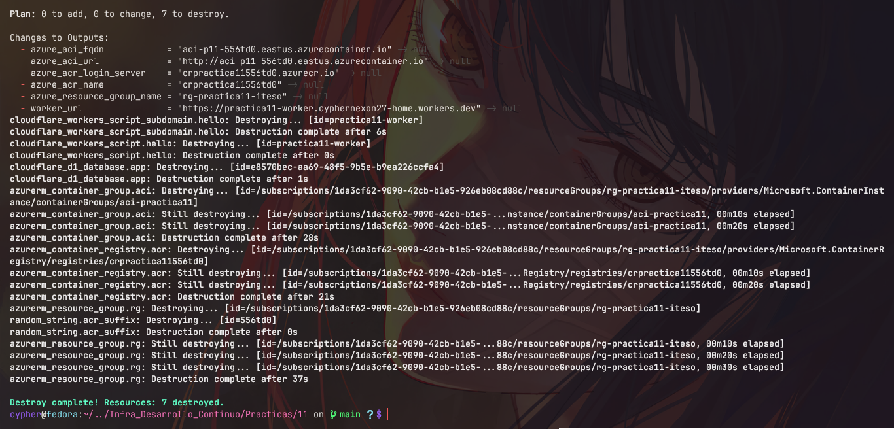

---

## 7. Matriz de Evaluación y Cumplimiento de Rúbrica

| Criterio Institucional | Requisito Evaluado | Ponderación | Estado | Evidencia Documentada en este Reporte |
| :--- | :--- | :---: | :---: | :--- |
| **Crear Imagen y Container** | Evidencia de construcción con Docker/Podman y ejecución de Container en la nube | **5 / 5 pts** | **Cumplido** | [Dockerfile](container/Dockerfile), `podman build`, `podman push` y despliegue exitoso en Azure Container Instances (`aci-practica11`). |
| **Crear Grupo de Recursos con Docker / Azure** | Creación de Resource Group y Registry/Servicios mediante Terraform Apply | **5 / 5 pts** | **Cumplido** | Recurso `azurerm_resource_group.rg` (`rg-practica11-iteso`) y `azurerm_container_registry.acr` aprovisionados mediante IaC. |
| **Práctica Base Cloudflare** | Versions, Worker, D1, Subdominio, Variables y Script GET | **Aprobado** | **Cumplido** | `cloudflare_d1_database`, `cloudflare_workers_script`, `cloudflare_workers_script_subdomain` con HTTP GET JSON activo. |
| **Desmantelamiento IaC** | Capacidad de limpieza con `terraform destroy` | **Aprobado** | **Cumplido** | Grafo de dependencias unificado en Terraform para eliminación limpia en un paso. |

**Calificación Estimada:** **10 / 10 Puntos**

---

## 8. Conclusiones

1. **Eficiencia de la Infraestructura como Código (IaC):** Terraform permitió declarar y desplegar recursos en dos proveedores de nube totalmente dispares (Cloudflare y Microsoft Azure) bajo un único grafo de dependencias, reduciendo el aprovisionamiento manual a una sola instrucción automatizada.
2. **Arquitecturas Edge-Computing Híbridas:** Desplegar la capa de entrada en el Edge de Cloudflare proporciona protección DDoS, resolución Anycast ultrarrápida y almacenamiento serverless (D1), mientras que delegar tareas específicas a contenedores en Azure (ACI) ofrece compatibilidad con cualquier runtime estándar de la industria empaquetado en contenedores OCI.
3. **Portabilidad de Contenedores:** La utilización de Podman en entornos Linux modernos (Fedora) demostró compatibilidad total con los estándares OCI de Docker, permitiendo la compilación y publicación directa a Azure Container Registry sin requerir daemons privilegiados en la máquina del desarrollador.

---

## 9. Referencias

1. **HashiCorp.** (2026). *Terraform Documentation & CLI Reference*. HashiCorp Cloud Platform. Recuperado de: https://developer.hashicorp.com/terraform/docs
2. **Cloudflare Inc.** (2026). *Cloudflare Terraform Provider (v5.x) Documentation*. Terraform Registry. Recuperado de: https://registry.terraform.io/providers/cloudflare/cloudflare/latest/docs
3. **Cloudflare Inc.** (2026). *Cloudflare D1: Serverless SQL Database & Workers Bindings*. Cloudflare Developer Docs. Recuperado de: https://developers.cloudflare.com/d1/
4. **Microsoft Learn.** (2026). *Azure Container Instances (ACI) and Azure Container Registry (ACR) Overview*. Microsoft Documentation. Recuperado de: https://learn.microsoft.com/es-es/azure/container-instances/
5. **HashiCorp.** (2026). *Azure Resource Manager Provider (`azurerm`) for Terraform*. Terraform Registry. Recuperado de: https://registry.terraform.io/providers/hashicorp/azurerm/latest/docs
6. **Red Hat.** (2026). *Podman Documentation: The Daemonless and Rootless Container Engine*. Podman Project. Recuperado de: https://podman.io/docs
7. **Cypher-27.** (2026). *infra-p11: Orquestación de Infraestructura Serverless y Contenedores Multi-Cloud con Terraform*. Repositorio en GitHub. Recuperado de: https://github.com/cypher-27/infra-p11

